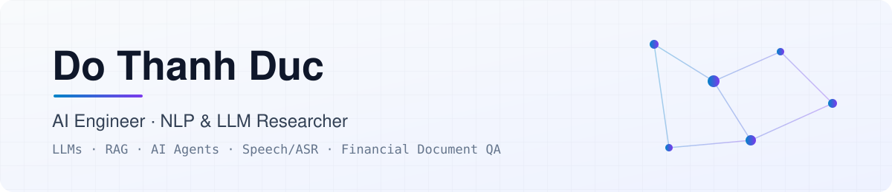

<picture>
  <source media="(prefers-color-scheme: dark)" srcset="assets/banner-dark.svg">
  
</picture>

  
  
  

I'm an **AI Engineer at C-OpenAI** and an **MSc student in Computer Science at HUST**. I build production LLM systems (agent runtimes, RAG knowledge bases, workflow agents and speech pipelines) and research retrieval-grounded reasoning over financial documents.

## 💼 Experience

**C-OpenAI** — AI Engineer · *Apr 2026 – Present*

| Project | What I work on |
|---------|----------------|
| **Agent Runtime** | Core service of the AI Platform: runs ReAct agents and streams each step over SSE. I own the **Context Builder** and **Context Compaction**, plus human-in-the-loop pause/resume, multi-agent planning and file handling. |
| **KA-KB** — Knowledge Agent & Knowledge Base | RAG knowledge base with **multimodal** document processing, so agents can answer from many document formats with citations. |
| **PC1** — Workflow Agent | Automated business operations with workflow agents; delivered a payment-document **matching and processing** system. |
| **Voice Fubon** — Speech AI | Vietnamese **ASR + speaker diarization** service for customer consulting and care. I deployed it on-premise, added a backward-compatible API layer, and wrote the handover. |

**MobiFone IT Center** — AI Engineer, Core NLP Team · *Aug 2025 – Apr 2026*
- Enterprise RAG chatbot on LangGraph: query rewriting with GPT-OSS-20B (**+12.5% NDCG@5**); answer quality on par with GPT-4o (LLM-as-a-Judge, 482 questions).
- 1POS AI Agent: multi-agent system that turns business questions into tool calls on POS/ERP data.

**Samsung R&D Vietnam** — AI Engineer, ASR Team · *Apr 2024 – Jul 2025*
- Fine-tuned Thai ASR (Whisper, Wav2Vec2, NeMo RNN-T) on ~2M utterances with Kubeflow on AWS; content accuracy went from **~86% to ~96%**.
- Built an audio augmentation and transcript normalization pipeline for on-device speech recognition.

Earlier: Research Assistant at BK.AI Lab, HUST (2023–2024) · NLP Intern at Aimesoft (2023)

## 🔬 Research

**Publications**
- **Do Thanh Duc**, Nguyen Nhat Minh, Le Thanh Huong. *AI_TLfanClub at FinMMEval 2026 Task 2: FiSCO-RAG for Cross-Lingual Evidence Recall in Financial Question Answering.* CLEF 2026 Working Notes, CEUR-WS Vol-4283, pp. 2864–2879. [[PDF]](https://ceur-ws.org/Vol-4283/paper210.pdf)
- **Do Thanh Duc**, Nguyen Nhat Minh, Le Thanh Huong. *AI_TLfanclub at FinMMEval 2026 Task 1: Distilled Qwen Models for Multilingual Financial Exam Question Answering.* CLEF 2026 Working Notes, CEUR-WS Vol-4283, pp. 2853–2863. [[PDF]](https://ceur-ws.org/Vol-4283/paper209.pdf)

**Ongoing**

| | Topic | Status |
|---|-------|--------|
| **LEDGER** | Fact-level retrieval and selective answering for numerical QA over financial reports | Paper in progress |
| **VLSP 2026 ViNumQA** | Program generation for Vietnamese financial QA over text, tables and charts | Shared task |
| **Neurosymbolic QA** | NL→FOL with RAG + Prover9 proofs; top-7 at the IJCNN 2025 challenge | Completed |

## 🛠️ Stack

`Python` · `PyTorch` · `Hugging Face` · `LangGraph` · `FastAPI` · `PostgreSQL / pgvector` · `Redis` · `MinIO` · `Qdrant` · `FAISS` · `NeMo` · `Whisper` · `Docker` · `Kubeflow` · `GitLab CI`

## 🎓 Education

**Hanoi University of Science and Technology (HUST)**: MSc in Computer Science (2024 – present) · BSc in Computer Science, Very Good, CPA 3.59/4.0 (2020 – 2024)

  
  

